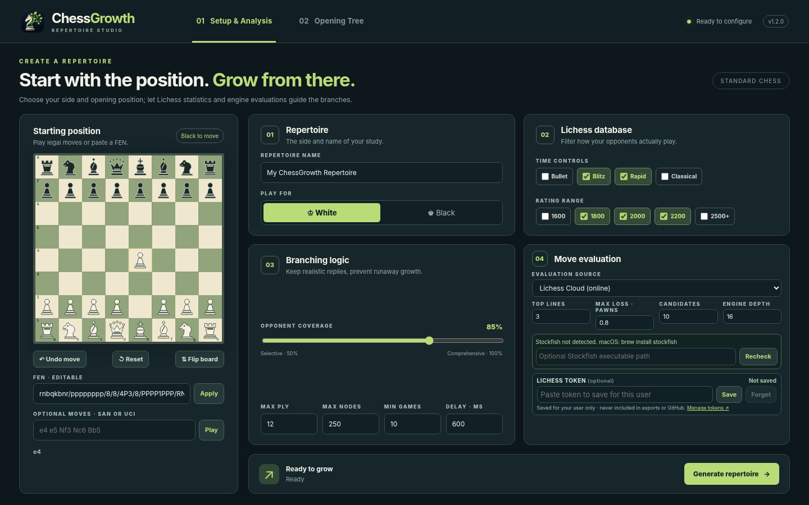
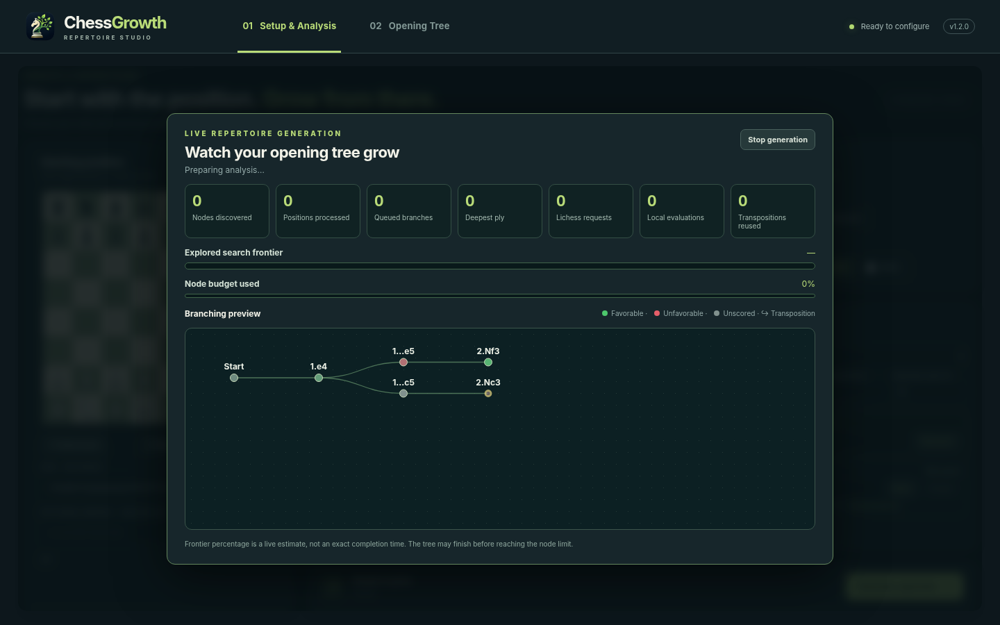
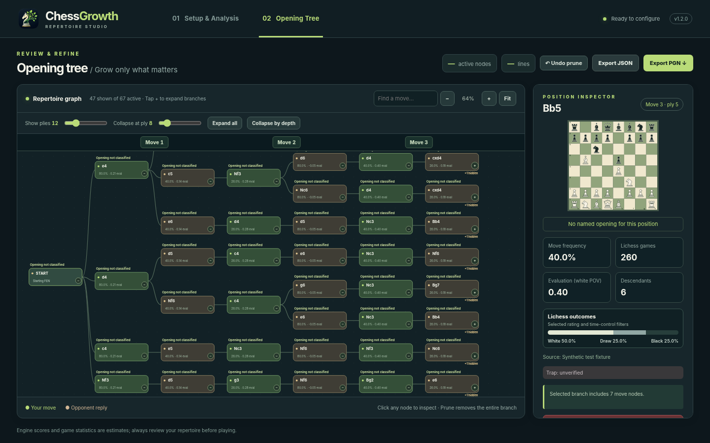

<div align="center">
  

  # ChessGrowth
  **Grow a smarter opening repertoire.**

  Standalone Go application for generating, reviewing and pruning a chess opening repertoire from Lichess statistics and optional Stockfish evaluations. No Python runtime or npm dependencies required.
</div>

## Interface

**1. Setup:** a fixed 64-square, single-SVG chessboard with bundled vector pieces (no layout shifts), Go-validated legal moves, editable FEN/SAN/UCI, repertoire color, Lichess filters, engine settings and a persistent optional API token.



**2. Live generation:** watch the labeled move tree grow in real time. Every plotted position shows its SAN move (and move number); green means favorable for your selected repertoire color, red means unfavorable, and gray means no evaluation. Scroll within the preview to explore the graph. Track unique expansions, transpositions reused, requests, evaluations and node-budget use.



**3. Opening Tree:** show opening names over nodes, collapse branches by depth or individually, limit visible depth, view full-move numbers in a synchronized ruler, inspect W/D/B rates and evaluations, remove subtrees, undo changes and export annotated PGN/JSON. Transposed positions link to the canonical node.



*Screenshots illustrate the interface with synthetic test data; they are not real Lichess statistics.*

## Download and run

Download the package for your operating system from **[GitHub Releases](https://github.com/MrPiada/ChessGrowth/releases/latest)**. Windows (`.exe`/optional `Setup.exe`), macOS (`.app`/`.dmg`), Ubuntu (`.deb`) and portable Linux binaries are supported. ChessGrowth runs a **localhost-only** web UI and opens your browser automatically.

Alternatively, install **Go 1.23+** and run:

```bash
go test ./...
go run .
```

The setup board always starts with White at the bottom; **Flip board** switches orientation independently of the repertoire color. Set your start position and parameters, then **Generate repertoire**. Once generated, the Opening Tree allows pruning individual branches and exporting the remaining repertoire.

## Transpositions and caching

ChessGrowth keeps a position index using the first four normalized FEN fields: **pieces, side to move, castling rights and capturable en-passant square**. Move clocks and move numbers are ignored for opening-theory transpositions. Every unique position is **scheduled for expansion at most once**. A second route into it is represented as a transposition link rather than a second subtree; its move is retained in the graph and the exported PGN contains a reference to the canonical node, without copying the complete continuation. Cloud/Stockfish evaluations and Explorer results are also memoized by position during generation; the disk HTTP cache uses the same normalized identity. This optimization is designed for opening repertoire analysis, not for adjudicating 50/75-move draws or move-history-dependent threefold repetitions.

The live preview shows early and recent branches, not every node of potentially huge searches. It pans to the current position and is scrollable. Color intensity is based on a smoothly saturated transformation of centipawn scores from the **repertoire player's point of view**; mate scores saturate. Unknown engine scores remain gray, never assumed drawn.

## Evaluations and PGN annotations

| Mode | Behavior |
| --- | --- |
| **Cloud → Stockfish fallback** | Use Lichess Cloud where available, otherwise run local Stockfish. **Recommended when Stockfish is installed**, and automatically selected on launch when detected. |
| **Lichess Cloud** | Cloud scores only; missing scores are explicitly identified. |
| **Stockfish only** | Evaluate the root and each retained node locally, including opponent continuations. |
| **Statistics only** | Do not call an engine; evaluation and trap verification are unavailable. |

Install Stockfish with `brew install stockfish` (macOS), `sudo apt install stockfish` (Ubuntu) or from [stockfishchess.org](https://stockfishchess.org/) (Windows). Use **Recheck** in the GUI. Local evaluation speed depends on the configured depth and number of positions; large trees can take time.

Every retained move is annotated with the standard **`[%eval 0.34]`** or **`[%eval #-3]`** directive *when an engine score exists*, along with its evaluation source, Lichess White/Draw/Black percentages, sample size, move frequency, opening classification (where available) and `Trap: yes/no/unverified`. The PGN headers record the chosen Lichess speed and rating filters. All engine scores are from White's point of view.

The trap indicator is deliberately a **practical heuristic, not a forced tactical proof**: a reply is a potential trap when an opponent move played in at least **5%** of filtered games worsens the opponent's engine evaluation by at least **1.50 pawns**, relative to the preceding position. The preceding player move is marked as a trap opportunity. Missing engine scores produce `unverified`, never an invented assessment. The heuristic is not a replacement for deeper tactical analysis.

Opening names come from Lichess Opening Explorer when available. When a child has no new classification, the last known opening family may be displayed with an **inherited** label. Unnamed positions are not assigned fabricated opening names.

## Lichess token

Public Explorer and Cloud queries usually work **without a token**. If desired, paste a token into **Setup → Move evaluation → Lichess token** and click **Save**. It persists across app restarts and updates for the same OS user; **Forget** deletes it. Tokens are never returned by the UI, included in PGNs, or sent to `explorer.lichess.org`.

- **macOS:** the user Keychain. The `security` utility receives the secret briefly as a process argument during saving.
- **Windows/Linux:** a user-private config file; *not encrypted at rest* (mode 0600 where supported).
- An explicit `LICHESS_TOKEN` environment variable overrides the saved token.

Do not commit credentials to Git and grant only the token permissions you need.

## Build distributables on macOS

```bash
brew install go gh python makensis
./scripts/build-release.sh v1.2.0
```

The build produces macOS Intel/Apple Silicon ZIPs and DMGs, Windows x64 ZIP and (with NSIS) `Setup.exe`, Ubuntu x64/ARM64 `.deb`, Linux TAR.GZ and SHA-256 checksums. A Windows development machine is **not** needed for cross-compilation. Binaries embed the HTML/CSS/JS and SVG chess pieces; executable icons are packaged for the native desktop environments. Stockfish is **not** bundled.

**Publish a release from an existing clone:** after testing and committing the source, tag `v1.2.0` and run:

```bash
gh release create v1.2.0 dist/ChessGrowth-v1.2.0-* dist/SHA256SUMS.txt \
  --verify-tag --title "ChessGrowth v1.2.0" \
  --notes-file RELEASE_NOTES_v1.2.0.md --latest
```

These installers are **unsigned and unnotarized**. Verify app behavior on the actual operating systems before making a stable release.

## Project notes

Standard chess only. Lichess data and evaluations are filtered estimates, not objective opening theory. The generator limits depth and nodes and respects API backoff; interactive pruning is kept in memory until export. Project inspired by [ChessRepertoireGenerator](https://github.com/MrPiada/ChessRepertoireGenerator) and the ChessPrune approach. Application code, UI and documentation were developed with assistance from ChatGPT.
